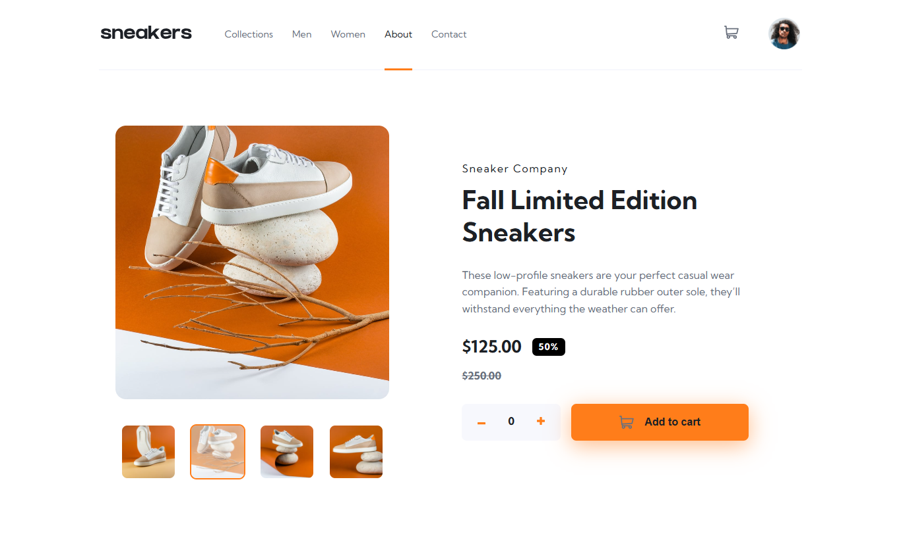

# Frontend Mentor - E-commerce product page solution

This is a solution to the [E-commerce product page challenge on Frontend Mentor](https://www.frontendmentor.io/challenges/ecommerce-product-page-UPsZ9MJp6). Frontend Mentor challenges help you improve your coding skills by building realistic projects.

## Table of contents

- [Overview](#overview)
  - [The challenge](#the-challenge)
  - [Screenshot](#screenshot)
  - [Links](#links)
- [My process](#my-process)
  - [Built with](#built-with)
  - [Useful resources](#useful-resources)
- [Author](#author)

## Overview

### The challenge

Users should be able to:

- View the optimal layout for the site depending on their device's screen size
- See hover states for all interactive elements on the page
- Open a lightbox gallery by clicking on the large product image
- Switch the large product image by clicking on the small thumbnail images
- Add items to the cart
- View the cart and remove items from it

### Screenshot

### Links

- Solution URL: (https://github.com/nouranelfar/E-commerce-product-page)
- Live Site URL: (https://nouranelfar.github.io/E-commerce-product-page/)

## My process
### Built with

- Semantic HTML5 markup
- CSS custom properties
- Flexbox
- Sass
- Mobile-first workflow
### Useful resources

- [Example resource 1](https://developer.mozilla.org/en-US/docs/Learn_web_development/Extensions/Forms/Form_validation) - This helped me in validation functions.
- [javascript info](https://javascript.info/) - This is an amazing article which helped me understand java script basics.
- [sass] (https://sass-lang.com/guide/) - this helped me styling with saas.

## Author

- Frontend Mentor - [@nouranelfar](https://www.frontendmentor.io/profile/nouranelfar)
- linkedIn - [nouran elfar] (https://www.linkedin.com/in/nouran-elfar-b5a0a3362/)